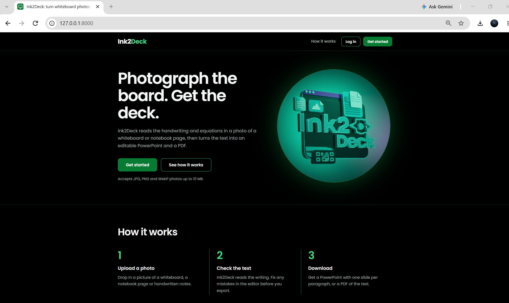
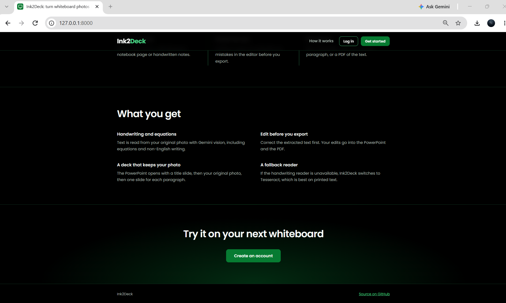
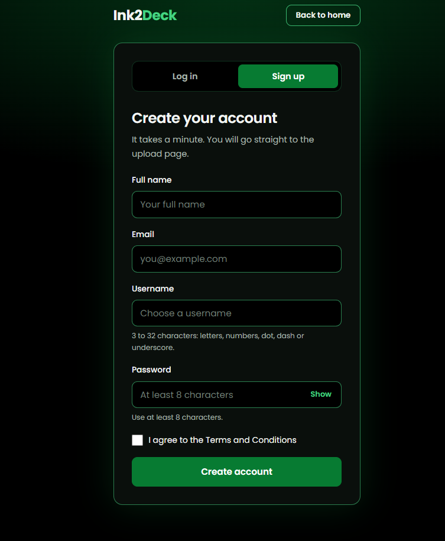
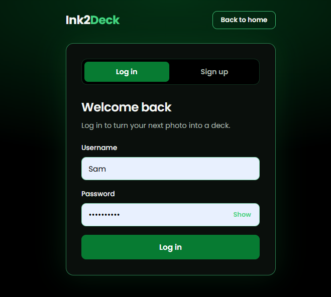
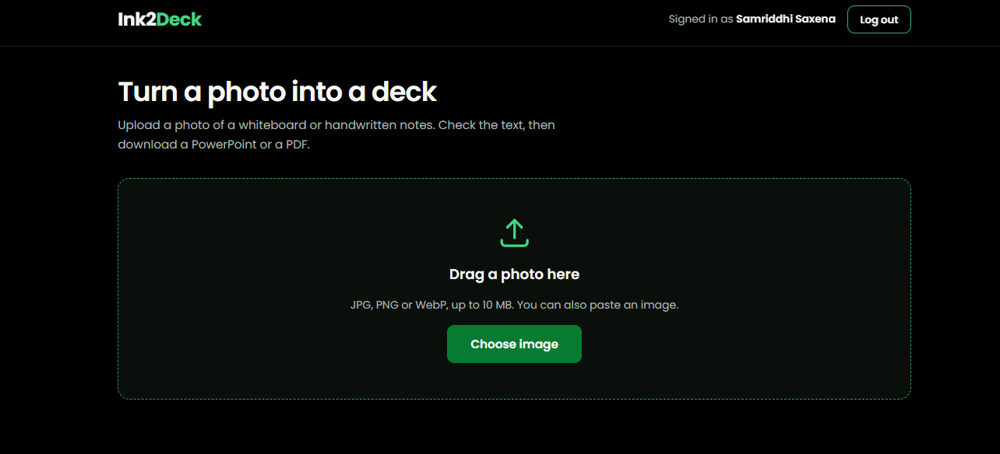
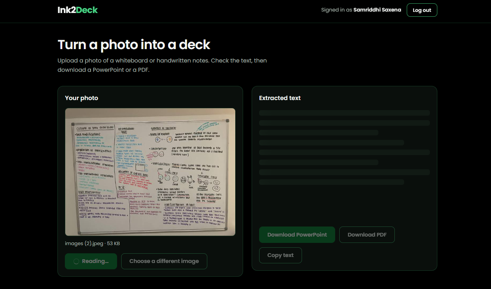
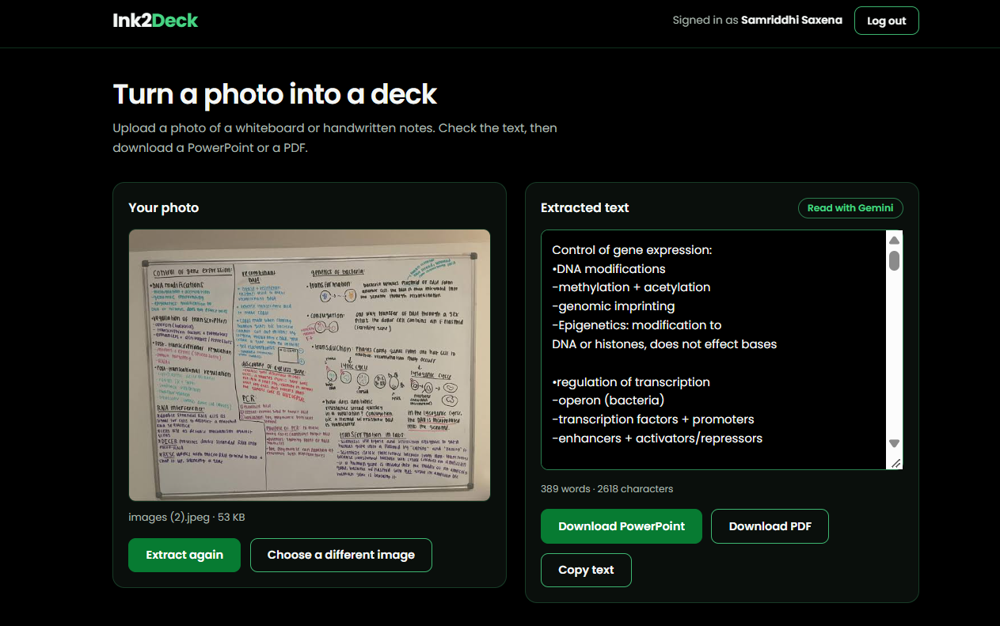

# Ink2Deck

**Turn whiteboard photos and handwritten notes into editable PowerPoint presentations and PDF files.**

Ink2Deck reads handwriting, notes, and equations from an image using Gemini Vision. Review and edit the extracted text before exporting it as a PowerPoint deck or PDF.

## Project links
- **Github Repository:** [https://github.com/samsaxas/Ink2Deck](https://github.com/samsaxas/Ink2Deck)
- **Local application:** [http://127.0.0.1:8000](http://127.0.0.1:8000) (available when running locally)

> The screenshots show the application running locally. A public live-demo link has not been provided.

## Screenshots

### 1. Landing page


### 2. How it works and features


### 3. Sign-up page


### 4. Login page


### 5. Upload workspace


### 6. Image processing


### 7. Extracted text editor


## Features

- **Handwriting and equation extraction:** Reads whiteboard photos, notebook pages, and handwritten notes using Gemini Vision.
- **Image upload:** Supports JPG, PNG, and WebP images up to 10 MB.
- **Flexible upload:** Supports drag and drop and pasting an image.
- **Text editing:** Review and correct extracted text before exporting.
- **PowerPoint export:** Creates a title slide, includes the original photo, and creates one slide per paragraph.
- **PDF export:** Generates a PDF with Unicode-safe text.
- **User accounts:** Sign-up, login, and session-based authentication.
- **Gemini fallback models:** Can try configured Gemini fallback models if the primary model fails.

## How it works

1. **Create an account or log in.** Accounts are stored in MongoDB when configured. Local development can use SQLite.
2. **Upload an image.** Select or drag and drop a JPG, PNG, or WebP image (up to 10 MB). You can also paste an image.
3. **Extract the writing.** Gemini Vision reads the original image and returns the extracted text.
4. **Review and edit.** Correct the extracted text in the editor.
5. **Export your files.** Download the edited content as a PowerPoint presentation or PDF.

## Technology stack

| Component | Technology |
|---|---|
| Backend | Python, FastAPI |
| Frontend | HTML, CSS, JavaScript |
| Handwriting recognition | Gemini Vision API |
| Database | MongoDB, with SQLite for local development |
| Export formats | PowerPoint (`.pptx`) and PDF |
| Deployment | Docker; compatible with Hugging Face Spaces |

## OCR and model behaviour

Ink2Deck uses **Gemini Vision only** for handwriting and image-text extraction. It does not use a local OCR fallback. The application does not install or call Tesseract, EasyOCR, PaddleOCR, or another OCR engine.

If Gemini and the configured fallback models fail, the API returns an error rather than silently switching to a different OCR engine.

There is no custom-trained handwriting recognition model in this project.

## Project structure

```text
Ink2Deck/
├── backend/
├── frontend/
├── tests/
├── Dockerfile
├── requirements.txt
├── requirements-dev.txt
├── run.py
└── .env.example
```

## Setup and local run

### 1. Create and activate a virtual environment

**Windows (Command Prompt):**
```bat
python -m venv .venv
.venv\\Scripts\\activate
```

**macOS / Linux:**
```bash
python -m venv .venv
source .venv/bin/activate
```

### 2. Install dependencies
```bash
pip install -r requirements.txt
```

### 3. Configure environment variables

Copy `.env.example` to `.env`.

**Windows:**
```bat
copy .env.example .env
```

**macOS / Linux:**
```bash
cp .env.example .env
```

Example `.env` configuration:
```env
SECRET_KEY=your_secret_key
MONGO_URI=
GEMINI_API_KEY=your_gemini_api_key
GEMINI_MODEL=gemini-2.5-flash
GEMINI_FALLBACK_MODELS=gemini-2.5-flash-lite
GEMINI_TIMEOUT_SECONDS=45
GEMINI_RETRIES=1
GEMINI_RETRY_DELAY_SECONDS=1.5
COOKIE_SECURE=0
COOKIE_SAMESITE=lax
```

Generate a secure secret key:
```bash
python -c "import secrets; print(secrets.token_hex(32))"
```

`GEMINI_API_KEY` is required. `MONGO_URI` can be left empty to use SQLite during development. Set `COOKIE_SECURE=1` behind HTTPS. Do not commit `.env` or API keys to GitHub.

### 4. Start the application
```bash
python run.py
```

Open [http://127.0.0.1:8000](http://127.0.0.1:8000).

## API endpoints

| Method | Endpoint | Description |
|---|---|---|
| `POST` | `/api/auth/signup` | Create an account and sign in |
| `POST` | `/api/auth/login` | Log in and set a session cookie |
| `POST` | `/api/auth/logout` | Log out |
| `GET` | `/api/auth/me` | Get current authentication status |
| `POST` | `/api/extract` | Extract text from an uploaded image |
| `POST` | `/api/export/pdf` | Export edited text as PDF |
| `POST` | `/api/export/pptx` | Export the original image and edited text as PowerPoint |
| `GET` | `/api/health` | Check storage backend and Gemini configuration |

The extraction and export endpoints require a logged-in session.

## Security

- Passwords use salted PBKDF2-SHA256 hashing.
- Existing accounts using the previous unsalted SHA-256 format can log in and are upgraded after their next successful login.
- Login is limited to 5 failed attempts per 10 minutes for each IP address and username.
- Sessions use signed, HTTP-only cookies.
- Uploaded files are validated as images and limited to 10 MB.

## Testing

Install development dependencies and run the tests:
```bash
pip install -r requirements-dev.txt
python -m pytest tests -q
```

The test suite covers Gemini model fallback, no-OCR failure behaviour, Unicode PDF export, PowerPoint structure, password hashing, API authentication, rate limiting, extraction, exports, and rejection of non-image uploads.

## Docker and Hugging Face Spaces

The project includes a `Dockerfile`. It does not install OCR system packages and serves on port `7860`. For Hugging Face Spaces, configure the required environment variables as Space secrets.

## Measuring extraction quality

Place each handwritten image beside its manually transcribed ground-truth text file, using matching names:
```text
test_data/
├── note1.jpg
├── note1.txt
├── note2.png
└── note2.txt
```

Run the evaluator:
```bash
python backend/evaluate.py test_data --engine gemini
```

The evaluator reports character error rate (CER) and word error rate (WER). Measure on your own representative test set and fill in the results:

| Engine | Number of images | CER | WER |
|---|---:|---:|---:|
| Gemini | Not yet reported | Not yet reported | Not yet reported |

*No accuracy figures are claimed because measured CER/WER results were not provided.*

## Limitations

- Extraction quality depends on image clarity, handwriting style, lighting, and note complexity.
- Gemini API availability, quotas, and response times can affect extraction.
- There is no offline OCR engine; extraction requires a working Gemini API configuration.

## Future improvements

- Add a larger, documented handwriting evaluation dataset.
- Improve slide layout and formatting controls.
- Add more export customisation options.
- Deploy a public demo.

## License

Add the project's chosen license before distributing or reusing the code.
